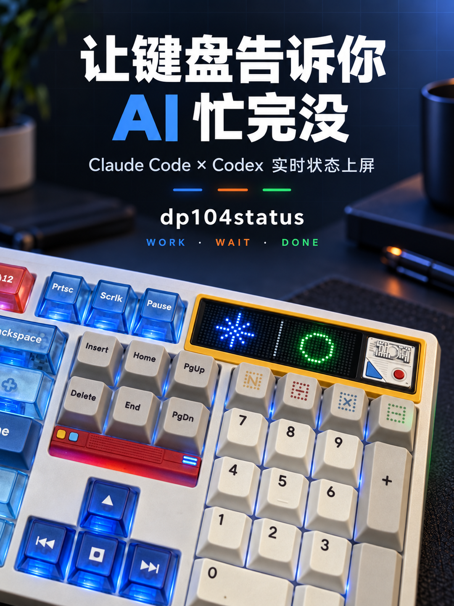

# dp104status



把 Claude Code 和 Codex 的工作状态显示在 Ticktype DP104 的点阵屏上。

屏幕 8×24 分成左右两半，各归一个 agent，颜色表示状态：

```
..#..#..#.......###.....     左：Anthropic 星芒 = Claude
...#.#.#.......#...#....     右：OpenAI 环     = Codex
....###.......#.....#...
..#######.....#..#..#...     蓝 = 在跑   橙 = 等你批准
....###.......#.....#...     绿 = 刚结束  暗灰 = 闲置
...#.#.#.......#...#....
..#..#..#.......###.....
........................
```

`./dp104status preview working waiting` 可以在终端里预览，不用碰硬件。

也可以用单行滚动文字（`CLAUDE WORK  CODEX WAIT`），见下面的显示方式。

**它跟着你的屏幕模式走，不改你的设置**：屏幕放在 CUSTOM，它就是常驻的状态屏；
放在 INFO 或别的模式，只在 agent 工作时借用，结束后原样还给你。

## 状态

每个产品两档，外加一个"需要你"：

| 显示 | 含义 | 触发事件 |
| --- | --- | --- |
| `WORK` | 在跑 | `UserPromptSubmit` `PreToolUse` `PostToolUse` `SubagentStart` |
| `WAIT` | 卡住了，等你批准 | `PermissionRequest` `Elicitation` |
| `DONE` | 本轮结束（默认显示 30 秒） | `Stop` |
| （不显示） | 闲置 | `SessionEnd`，或 TTL 过期 |

`WAIT` 优先级高于 `WORK`：任一会话在等你，就先告诉你这件事。

不区分成功和失败。Codex 目前没有失败专用 hook，硬做红灯只能靠猜文本，不如不做。

## 构建

零依赖，只要 Xcode Command Line Tools：

```bash
swiftc -O dp104status.swift -o dp104status
```

## 用法

```bash
./dp104status daemon                # 常驻，驱动屏幕
./dp104status hook <claude|codex>   # 从 stdin 读一个 hook 事件（由 agent 调用）
./dp104status status                # 当前会渲染成什么，屏幕是否被借用
./dp104status probe                 # 只读查看键盘：屏幕模式、亮度、多久休眠
./dp104status restore               # 手动归还被借用的屏幕
./dp104status config display <d>    # mixed / pixel / text
./dp104status hooks <claude|codex>  # 打印要安装的 hook 配置
./dp104status preview <a> <b>       # 终端预览图形，参数是两个 agent 的状态
./dp104status pixel-test            # 诊断像素链路（需先停 daemon）
```

### 屏幕跟随你的模式

没有"闲置时停在哪"的设置——由你自己用键盘上的切换键决定：

| 你把屏幕放在 | agent 工作时 | agent 全部空闲后 |
| --- | --- | --- |
| **CUSTOM** | 原地画状态，不切模式 | 原地画暗灰仪表盘 |
| **其他模式**（INFO 等） | 借用：切去显示状态 | 切回你原来的模式，文字原样恢复 |

**借用期间你按了切换键，就是你把屏幕要回去了**：它立刻放手，直到 agent 全部
空闲之前都不会再借。切**到** CUSTOM 则相反——那是在说"我要看状态屏"。

借用开始时才记下你当时的模式和文字（不是 daemon 启动时），所以你中途改过的
设置不会被旧值覆盖。借用记录在 `~/.dp104status/takeover.json`，daemon 意外退出后，
下一次启动会先把屏幕还给你。

### 显示方式

```bash
./dp104status config display mixed  # 默认：像素链路通就画图标，不通就用滚动文字
./dp104status config display pixel  # 只用图标；链路不通时不碰你的屏幕
./dp104status config display text   # 只用滚动文字：只走 HID，最稳
```

改完需要重启 daemon（命令会提示怎么做）。

### 安装 hooks

Claude Code —— 把输出合并进 `~/.claude/settings.json`：

```bash
./dp104status hooks claude
```

Codex —— 用桌面版内置的 CLI 注册本地 marketplace 并安装插件：

```bash
codex plugin marketplace add /absolute/path/to/dp104status/codex
codex plugin add dp104status@dp104status
```

然后在这个仓库里启动一次 `codex --no-alt-screen`：

1. 如果出现目录信任提示，选 `Yes, continue`。
2. 出现 `Hooks need review` 后先检查命令，再选 `Trust all and continue`。
3. 回到桌面版新建一个任务验证；已经打开的任务可能仍使用旧的 hook 快照。

Codex 会按 hook 内容保存信任哈希。以后修改插件 hook 时需要重新安装并审批；
不要手动复制 `hooks.state` 中的哈希。更详细的排查和验证见
`CODEX-INTEGRATION.md`。

### 远程（SSH）会话

hook 在 **agent 运行的那台机器上**执行。通过 SSH 打开的 Claude Code 会话、
或在远程服务器上跑的 Codex 任务，它们的 hook 在远端触发，那里既没有这个二进制
也没有键盘——所以纯本地的 daemon 看不到它们。

daemon 可以额外监听一个**仅回环**的端口，让远端通过 SSH 反向隧道把事件报回来：

```bash
./dp104status config remote 47104      # 开启；off 关闭
```

在 Mac 的 `~/.ssh/config` 里给那台服务器加一行反向转发，这样所有到它的 SSH
连接都会自动带上隧道，包括桌面端自己发起的：

```
Host your-server
    RemoteForward 47104 127.0.0.1:47104
```

在远端装上转发脚本，并把该机器的 hook 配置指向它：

```bash
# 在 Mac 上生成，内容拷到远端
./dp104status remote-hook claude > remote-hook-claude.sh
./dp104status remote-hook codex  > remote-hook-codex.sh
```

脚本用 bash 的 `/dev/tcp`，远端零依赖，且**所有失败路径都 exit 0**——
隧道没通绝不会拖累 agent。它只发送 daemon 本来就读的那几个字段，
prompt 和工具输出留在远端。

监听只绑 `127.0.0.1`，不绑任何可路由地址；`ssh -R` 默认也只在远端回环监听。

### 开机自启

```bash
cp com.skyler.dp104status.plist ~/Library/LaunchAgents/
launchctl load ~/Library/LaunchAgents/com.skyler.dp104status.plist
```

停掉：

```bash
launchctl unload ~/Library/LaunchAgents/com.skyler.dp104status.plist
```

## 设计

```
Claude/Codex hook 事件
      ↓  (短命进程，flock 下原子写，然后立刻退出)
~/.dp104status/state.json
      ↓  (常驻 daemon 轮询，唯一的 HID 持有者)
DP104 点阵屏  (VIA CUSTOM_MENU_SET_VALUE)
```

**hook 进程绝不打开键盘。** 它解析事件、更新状态文件、退出，而且无论如何都 `exit(0)`——
键盘拔了、daemon 没开、状态文件锁不住，都不会让你的 agent 报错或变慢。

**daemon 是唯一的 HID 持有者。** 只在借用时改动屏幕，归还时把借用那一刻记下的
模式和文字原样写回。写模式前先看当前值，已经是目标值就不写——重新进入 CUSTOM
会让固件重载它存储的那一帧，同值写入也不是没有代价的。

**不碰 flash。** 全程只发 VIA `CUSTOM_MENU_SET_VALUE` (0x07)，这是 RAM 写入、立即生效。
`CUSTOM_MENU_SAVE` (0x09) 一次都不发，所以高频状态变化不会磨损 EEPROM，
拔插键盘也会让它回到你自己保存的设置。

**键盘休眠不是拔线。** DP104 默认 5 分钟没按键就休眠，这期间 HID 和像素链路都不应答。
插拔只看 IOKit 的设备插拔回调；写入失败只当作"暂时没应答"，按 2→4→5 秒退避、
期间不碰键盘，醒来后重绘一次、重开一次像素链路。

**先确认能画，再切 CUSTOM。** 借用前先探测像素链路，通了才切模式；切过去之后
上传失败就立刻切回去——固件存储的那一帧永远不会留在屏幕上。像素链路不应答时按
15 秒起、翻倍到 5 分钟的退避重试，不会对着一条死链路反复敲。

owner 键是 `{product}:{session_id}:{agent_id}`，子代理独立跟踪，
`Stop` 会连带清掉同会话的子 owner——避免子代理结束时整块屏幕闪一下 DONE。
Claude 与 Codex 的并发 hook 通过独立的 `state.lock` 串行更新，避免原子替换
`state.json` 时丢掉另一边的 owner。

协议细节见 `DP104-PROTOCOL.md`。

## 排查

`~/.dp104status/` 下有两份日志：

| 文件 | 内容 |
| --- | --- |
| `daemon.log` | 渲染了什么、串口状态、键盘插拔 |
| `events.log` | 每个 hook 事件的到达顺序 |

`events.log` 每行记录时间、产品、事件名、会话前 8 位和 agent id——
**不记录 prompt、工具输出或对话内容**，超过 256KB 自动截断。

状态不对时先看它：能直接看出某个 agent 到底发了哪些事件、按什么顺序，
以及是不是压根没发。

`daemon.log` 里的几种正常现象：

| 日志 | 意思 |
| --- | --- |
| `keyboard not answering (asleep?)` / `keyboard awake` | 键盘休眠和醒来，正常 |
| `you switched the screen to … — leaving it to you` | 你按了切换键，它放手了 |
| `idle — screen handed back (INFO)` | 借用结束，屏幕还给你 |
| `pixel link not answering — next try in …` | 像素链路暂时不通；mixed 下会先用文字 |

### 端到端测试

`tests/e2e.py` 在真键盘上跑一遍借用、归还、放手、常驻、崩溃恢复、文字模式，
每条断言都读回模式寄存器和文字槽来判定，不靠目测。会让屏幕来回切换约两分钟，
结束时回到 INFO 和你的文字。用法见文件开头。

## 已知限制

- 只在 **USB 有线** 下验证过。2.4G / 蓝牙模式下 Raw HID 是否可用未测。
- 屏幕文本是 ASCII，30 字符上限，会自动转大写。
- daemon 用轮询（400ms）而不是文件监听，够用且简单。
- 若固件里存储的 CUSTOM 帧不是仪表盘（比如早期测试留下的纯色帧），常驻模式下
  键盘刚醒来的几秒内可能先露出它，随后被重绘覆盖。

## 授权

**GPL-3.0-only**（见 `LICENSE`）。分发编译产物时需要按许可条款一并提供对应源码。

DP104 的通信协议没有官方文档，是通过阅读厂商自托管的 VIA 分支前端并在实机上
验证得到的。VIA 本身也是 GPL-3.0。协议来源、参考过的项目、以及图形的说明见
`NOTICE.md`。

本项目与 Ticktype、NuPhy、Anthropic、OpenAI 无关，也未获得其背书。
